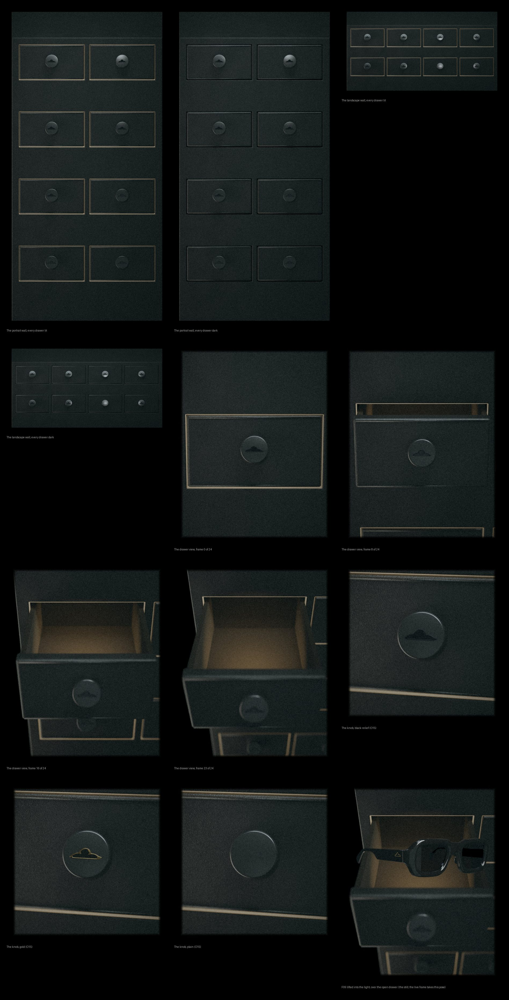

# R1 · the founder's first look

Made by `tools/blender/wall_export.py r1` on the renders in `work/wall/` (DRAWER-WALL.md, D3). Every image is graded as the wall is. Black relief is the knob's default (O15); the gold and plain close-ups are the alternatives. Answer on the D3 pull request.

- The portrait wall, every drawer lit: `wall-portrait-lit.jpg`
- The portrait wall, every drawer dark: `wall-portrait-dark.jpg`
- The landscape wall, every drawer lit: `wall-landscape-lit.jpg`
- The landscape wall, every drawer dark: `wall-landscape-dark.jpg`
- The drawer view, frame 0 of 24: `view-00.jpg`
- The drawer view, frame 8 of 24: `view-08.jpg`
- The drawer view, frame 16 of 24: `view-16.jpg`
- The drawer view, frame 23 of 24: `view-23.jpg`
- The knob, black-relief (O15): `knob-black-relief.jpg`
- The knob, gold (O15): `knob-gold.jpg`
- The knob, plain (O15): `knob-plain.jpg`
- F09 lifted into the light, over the open drawer (the still; the live frame takes this pose): `lifted-F09.jpg`
